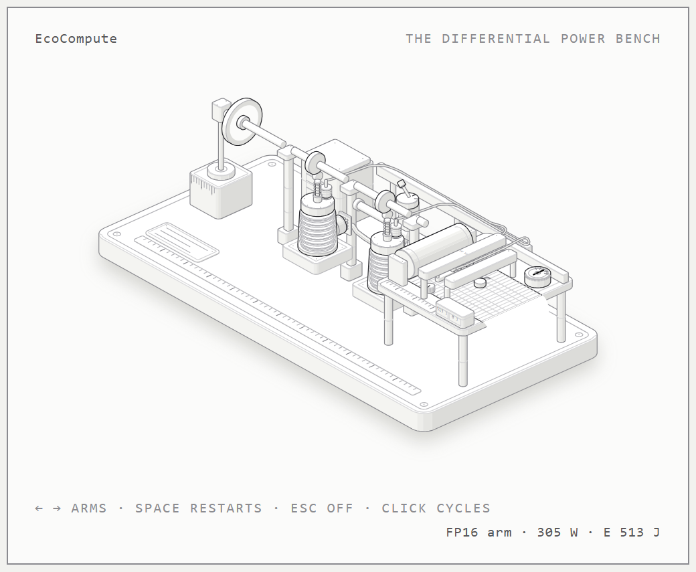

# 👋 Hi, I'm Hongping Zhang

Independent AI Researcher | Energy Efficiency & Sustainable Computing

> I measure how much energy LLM inference **actually** costs — GPU package power, NVML, CV < 2% — and publish every number with its basis. No FLOPs math, no vendor specs.

---

## 🔬 Core Discovery

> **NF4 crossover ranges from ~1.1–1.5B (Blackwell, current stack) to ~3.7B (Ada).**
> Below the crossover, quantization costs more energy; above it, quantization saves. The crossover belongs to a card+stack combination, not to an architecture.
> — Measured on RTX 4090D, RTX 5090, A800 with NVML power sampling.

This finding challenges the default assumption that "quantize everything = green." All benchmark data is open and reproducible.

**Key Findings:**
- **NF4 crossover**: ~2.1B (Turing T4) → ~3.7B (Ada 4090) → ~4.8B (Blackwell 5090 v1.1.0); **1.1–1.5B on the same 5090** with a newer stack (bitsandbytes 0.50.2, cross-restart A/B sessions — [deep-dive record](https://doi.org/10.5281/zenodo.22855133))
- **INT8 (`load_in_8bit=True`)**: default increases energy +17–147% vs FP16; set `llm_int8_threshold=0.0` to recover +79% throughput and −36% energy
- **Below crossover**: NF4 adds 11–29% energy (Blackwell, small models)
- **Above crossover**: NF4 saves 8–35% energy (Ada, models ≥6B)
- **Thermal state**: a steady-state card (53–54 °C) costs **+4.1%** more energy per token than the same config launched cold (37–39 °C) — energy claims without a thermal block are not comparable at the few-percent level ([cold vs steady dataset](https://doi.org/10.5281/zenodo.24046432))

---

*NF4 / INT8 / FP8 energy per token relative to FP16 at batch size 1. The crossover moves with model size, hardware and library version — measure before you claim. Data: [EcoCompute Benchmark Dataset v1.1.0](https://doi.org/10.5281/zenodo.19647290), reproduce it with [ecocompute-mlcube](https://github.com/hongping-zh/ecocompute-mlcube).*

---

*How those numbers are made: the **differential method** as an interactive isometric diagram - a two-arm power bench, spinning flywheel, chart recorder, live readouts (arrow keys switch arms, space starts a fresh strip on the recorder). Open it: [quantenergy.tech/bench](https://quantenergy.tech/bench/) (dark and light themes, self-contained single file).*

---

## 🚪 Three Ways In

| # | What | Where |
|---|------|-------|
| 1 | **Run the measurement container** — reproduce every number on your own GPU (MLCube, NVML, MLCommons-style energy reporting) | [**ecocompute-mlcube** →](https://github.com/hongping-zh/ecocompute-mlcube) |
| 2 | **Use the web estimator** — compare precision choices for your GPU × model size, every answer states its basis and confidence | [**quantenergy.tech** →](https://quantenergy.tech) |
| 3 | **Ask your AI assistant** — EcoCompute is listed in the [official MCP Registry](https://registry.modelcontextprotocol.io/v0.1/servers?search=ecocompute-estimator) (`io.github.hongping-zh/ecocompute-estimator`, 4 tools; Claude Desktop / Cursor setup in the [announcement post](https://quantenergy.tech/blog/make-your-ai-assistant-ask-about-energy-first)) | [MCP endpoint →](https://ecocompute-estimator.zhanghongping1982.workers.dev/mcp) |

*Also: an interactive [Accuracy × Cost × Carbon dashboard →](https://hongping-zh.github.io/), and a [GitHub Action →](https://github.com/hongping-zh/hongping-zh-ecocompute-action) that lints CI for LLM energy waste.*

---

## 📈 Recognition & Impact

| Achievement | Details |
|-------------|---------|
| **🤗 HuggingFace Optimum** | Quantization energy findings cited in the official documentation ([optimum PR #2410](https://github.com/huggingface/optimum/pull/2410)) |
| **🏛️ MLCommons** | Invited discussion on quantization energy metrics for MLPerf Inference ([inference #2558](https://github.com/mlcommons/inference/issues/2558)) |
| **🔥 torchao maintainers** | Independently confirmed the RTX 5090 FP8 energy anomaly we reported; we later reproduced it on **stable torchao 0.18**, with both FP8 code paths characterized (weight-only penalty rises with size, dynamic-activation falls) ([ao #4094](https://github.com/pytorch/ao/issues/4094)) |
| **⬆️ Upstream contributions** | bitsandbytes PR #1882 · transformers PR #44407 |
| **📊 Open dataset** | 360+ configurations across 4 GPU architectures (Turing, Ampere, Ada, Blackwell), CV < 2% |
| **🌍 Zenodo (CC BY 4.0)** | [10.5281/zenodo.19647290](https://doi.org/10.5281/zenodo.19647290) (main, v1.1.0) · [10.5281/zenodo.22037483](https://doi.org/10.5281/zenodo.22037483) (RTX 4090 deep dive) · [10.5281/zenodo.22855133](https://doi.org/10.5281/zenodo.22855133) (RTX 5090 deep dive, 4 precisions × cross-restart) · [10.5281/zenodo.24046432](https://doi.org/10.5281/zenodo.24046432) (cold vs steady thermal experiment) |

---

## 🙏 Acknowledgments

- **@gkgoing** — first independent replication (2026-08): TinyLlama-1.1B in NF4 on an RTX 3050 Ti Laptop. The perplexity matched our RTX 4090 measurement to four decimals; the energy number did not — and that contrast is the reason this project exists. [Submission →](https://github.com/hongping-zh/ecocompute-mlcube/issues/15)
- **@OliverYanghoo** — second independent replicator (2026-11): three NF4 runs on a Tesla V100S-PCIE-32GB (TinyLlama-1.1B −1.7%, Qwen2.5-3B −7.9%, Qwen2.5-7B −3.6%) — the project's first Volta-architecture data and the first whole architecture class filled by one contributor. All three sizes save energy, consistent with the bandwidth-starvation hypothesis. Disclosed deviation: torch 2.6.0+cu124 (the pinned CUDA-13 stack ships no sm70 kernel for Volta), plus a real bug report (`--gpu_arch auto` misses "V100S"). [#42](https://github.com/hongping-zh/ecocompute-mlcube/issues/42) [#43](https://github.com/hongping-zh/ecocompute-mlcube/issues/43) [#44](https://github.com/hongping-zh/ecocompute-mlcube/issues/44)
- **@amarjithkumar2007-wq** — AMD GPU (ROCm) detection and fallback (PR #20); context_length applied in measurement path (PR #22); mock-tested ROCm power/temperature telemetry sampler (PR #31) — now co-author on the container's software record and the cold–steady dataset.
- **@yesheng-oss** — backend contribution guide (PR #21): documents how to add llama.cpp, vLLM, or TensorRT-LLM as inference engines.

---

## 🎯 Roadmap

- ✅ HuggingFace integration published · ✅ MLCommons engagement · ✅ MCP Registry listing
- 🔄 arXiv: "When Does Quantization Save Energy?" — seeking endorsement
- 🛡️ VS Code extension: real-time energy linting before code merges
- 🤝 Enterprise pilots: carbon-aware CI/CD design partners

---

## 💚 How You Can Help

| Action | Link |
|--------|------|
| ⭐ **Star / run the container** | [ecocompute-mlcube](https://github.com/hongping-zh/ecocompute-mlcube) — an independent replication is the most valuable contribution |
| 📊 **Submit a measurement** | [Contribution guide →](https://github.com/hongping-zh/ecocompute-mlcube/blob/main/CONTRIBUTING.md) — your GPU + model + precision, CC BY 4.0 into the dataset |
| 📧 **arXiv endorsement** | [Email me →](mailto:zhanghongping1982@gmail.com?subject=arXiv%20Endorsement) |
| 🤝 **Design partner / pilot** | [Email me →](mailto:zhanghongping1982@gmail.com?subject=EcoCompute%20Design%20Partner) |

---

## 📚 Key Resources

- **Website & estimator**: [quantenergy.tech](https://quantenergy.tech) · [MCP registry listing](https://quantenergy.tech/blog/make-your-ai-assistant-ask-about-energy-first)
- **Dataset**: [GitHub (container + replication)](https://github.com/hongping-zh/ecocompute-mlcube) | [HuggingFace card](https://huggingface.co/datasets/hongpingzhang/ecocompute-energy-efficiency) | [Zenodo DOI](https://doi.org/10.5281/zenodo.19647290)
- **Tutorials (Chinese)**: [GPU 能耗测量入门 series →](https://cloud.tencent.com/developer/column/109571) — hands-on: from reading watts to a reproducible measurement protocol
- **Paper**: "When Does Quantization Save Energy? Empirical Analysis of the Energy-Efficiency Crossover Effect Across GPU Generations" (arXiv in progress)

---

  <i>🌍 Making AI development more sustainable, one measured number at a time.</i>

---

**Trademarks**: MLCommons, MLPerf and MLCube are trademarks of MLCommons Association, used nominatively.

